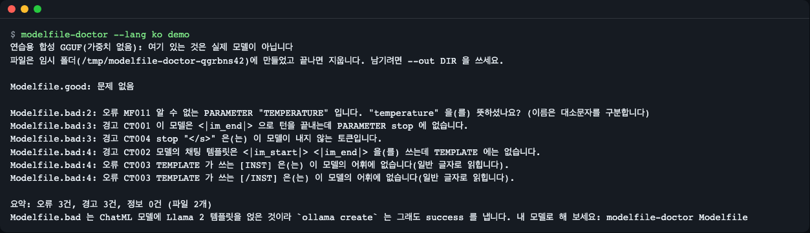
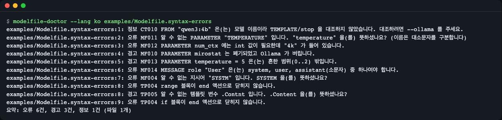
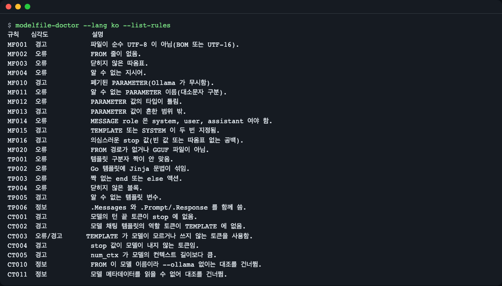
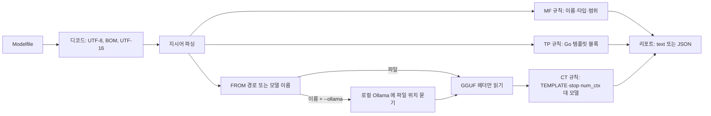

# modelfile-doctor

[English](README.md) | **한국어**

[](https://github.com/LeeGyeongPil/modelfile-doctor/actions/workflows/ci.yml)  [](LICENSE)

`ollama create` 를 실행하기 전에 Ollama `Modelfile` 을 검사합니다. 문법 오류를 줄 번호와 함께 한 번에 모두 보여 주고, Ollama 자신은 하지 않는 일인 `TEMPLATE`·`stop` 값과 GGUF 모델 파일 안에 저장된 채팅 형식의 대조까지 합니다. 영어·한국어 출력을 지원하고 런타임 의존성이 없습니다.


*내장 데모: `Modelfile.good` 은 통과하고, `Modelfile.bad`(ChatML 모델에 Llama 2 방식 템플릿)는 오류 3건·경고 3건이 나옵니다.*

## 왜 필요한가
이런 Modelfile 은 `ollama create` 를 통과합니다. Ollama 는 파일이 파싱되는지만 보기 때문입니다.

```text
FROM ./model.gguf
PARAMETER stop "</s>"
TEMPLATE """[INST] {{ .Prompt }} [/INST]"""
```
모델이 ChatML 모델이면 `[INST]` 는 그 모델에게 특수 토큰이 아니고 `</s>` 는 나오지 않으므로, 답이 엉망이거나 끝나지 않습니다. `modelfile-doctor` 는 이 줄들을 GGUF 에 저장된 채팅 형식과 비교해, 모델을 만들기 전에 알려 줍니다.

## 이런 분께
- GGUF 파일을 받아 직접 `Modelfile` 을 쓰는데, `ollama create` 는 `success` 라고 했지만 모델이 횡설수설하거나 끝나지 않는 분.
- `Modelfile` 의 오타(파라미터 이름, 값 타입, 메시지 role, 템플릿 블록)를 한 번에 다 보고 싶은 분. 시도할 때마다 오류가 하나씩만 나오는 것이 불편한 경우.
- CI 나 pre-commit 단계에서 JSON 출력과 종료 코드로 검사하고 싶은 분.

## 설치
Python 3.10 이상이 필요합니다. [uv](https://docs.astral.sh/uv/) 가 없다면 먼저 설치하세요(`curl -LsSf https://astral.sh/uv/install.sh | sh`). 최소 리눅스 이미지에서는 `git` 과 `curl` 도 있어야 합니다.

```bash
# clone 해서 쓰기 (이 README 를 확인한 방법)
git clone https://github.com/LeeGyeongPil/modelfile-doctor
cd modelfile-doctor
uv sync
uv run modelfile-doctor --version
```
```text
modelfile-doctor 0.2.0
```

명령을 PATH 에 두려면 `uv tool install git+https://github.com/LeeGyeongPil/modelfile-doctor` 를 쓰세요. 런타임 의존성은 없습니다. `gguf`·`numpy` 는 테스트에서만 씁니다.

## 빠르게 시작하기
데모는 모델도 Ollama 서버도 필요 없습니다. 아주 작은 연습용 GGUF(헤더만 있고 가중치 없음, 실행할 수 없음)와 Modelfile 두 개를 만들어 실제 규칙 엔진으로 검사합니다.

```bash
uv run modelfile-doctor demo --lang ko
```
```text
연습용 합성 GGUF(가중치 없음): 여기 있는 것은 실제 모델이 아닙니다
파일은 임시 폴더(/tmp/...)에 만들었고 끝나면 지웁니다. 남기려면 --out DIR 을 쓰세요.

Modelfile.good: 문제 없음

Modelfile.bad:2: 오류 MF011 알 수 없는 PARAMETER "TEMPERATURE" 입니다. "temperature" 을(를) 뜻하셨나요? (이름은 대소문자를 구분합니다)
Modelfile.bad:3: 경고 CT001 이 모델은 <|im_end|> 으로 턴을 끝내는데 PARAMETER stop 에 없습니다.
Modelfile.bad:3: 경고 CT004 stop "</s>" 은(는) 이 모델이 내지 않는 토큰입니다.
Modelfile.bad:4: 경고 CT002 모델의 채팅 템플릿은 <|im_start|> <|im_end|> 을(를) 쓰는데 TEMPLATE 에는 없습니다.
Modelfile.bad:4: 오류 CT003 TEMPLATE 가 쓰는 [INST] 은(는) 이 모델의 어휘에 없습니다(일반 글자로 읽힙니다).
Modelfile.bad:4: 오류 CT003 TEMPLATE 가 쓰는 [/INST] 은(는) 이 모델의 어휘에 없습니다(일반 글자로 읽힙니다).

요약: 오류 3건, 경고 3건, 정보 0건 (파일 2개)
Modelfile.bad 는 ChatML 모델에 Llama 2 템플릿을 얹은 것이라 `ollama create` 는 그래도 success 를 냅니다. 내 모델로 해 보세요: modelfile-doctor Modelfile
```
각 줄은 `파일:줄: 심각도 규칙 메시지` 형식입니다. `MF` 규칙은 Modelfile 문법, `CT` 규칙은 모델과의 대조입니다. 데모는 연습용(mock) 모드입니다. 모델이 합성이라 검사가 어떻게 동작하는지만 보여 주고, 실제 모델의 답변은 알려 주지 않습니다.

## 사용법
| 명령·옵션 | 하는 일 | 예 |
|---|---|---|
| `modelfile-doctor PATH...` | Modelfile 하나 이상 검사 | `modelfile-doctor Modelfile` |
| `demo [--out DIR]` | 연습용 데모 실행, `--out` 은 만든 파일을 남김 | `modelfile-doctor demo --out ./demo-files` |
| `inspect FILE.gguf` | GGUF 헤더의 채팅 관련 값 출력 | `modelfile-doctor inspect model.gguf` |
| `--ollama [URL]` | `FROM 모델:태그` 를 로컬 Ollama 서버로 해석(기본 `$OLLAMA_HOST` 또는 `http://127.0.0.1:11434`) | `modelfile-doctor --ollama Modelfile` |
| `--format text\|json` | 출력 형식 | `modelfile-doctor --format json Modelfile` |
| `--strict` | 경고도 종료 코드 1 | `modelfile-doctor --strict Modelfile` |
| `--select IDS` / `--ignore IDS` | 규칙만 실행 / 건너뜀(id 또는 접두사, 쉼표 구분) | `modelfile-doctor --select CT Modelfile` |
| `--list-rules` | 모든 규칙과 심각도 표시 | `modelfile-doctor --list-rules` |
| `--lang en\|ko`, `--no-color` | 출력 언어, 색 끄기 | `modelfile-doctor --lang ko Modelfile` |

종료 코드: `0` 오류 없음, `1` 오류 있음(`--strict` 면 경고 포함), `2` 사용법·입출력 문제(없는 파일, 읽을 수 없는 GGUF, Ollama 연결 불가).

### 시나리오 1: 문법 오류를 한 번에 찾기
레포의 `examples/Modelfile.syntax-errors` 는 거의 모든 줄에 오타가 있습니다.

```bash
uv run modelfile-doctor --no-color --lang ko examples/Modelfile.syntax-errors
```
```text
examples/Modelfile.syntax-errors:1: 정보 CT010 FROM "qwen3:4b" 은(는) 모델 이름이라 TEMPLATE/stop 을 대조하지 않았습니다. 대조하려면 --ollama 를 주세요.
examples/Modelfile.syntax-errors:2: 오류 MF011 알 수 없는 PARAMETER "TEMPERATURE" 입니다. "temperature" 을(를) 뜻하셨나요? (이름은 대소문자를 구분합니다)
examples/Modelfile.syntax-errors:3: 오류 MF012 PARAMETER num_ctx 에는 int 값이 필요한데 "4k" 가 들어 있습니다.
examples/Modelfile.syntax-errors:4: 경고 MF010 PARAMETER mirostat 는 폐기되었고 Ollama 가 버립니다.
examples/Modelfile.syntax-errors:5: 경고 MF013 PARAMETER temperature = 5 은(는) 흔한 범위(0..2) 밖입니다.
examples/Modelfile.syntax-errors:6: 오류 MF014 MESSAGE role "User" 은(는) system, user, assistant(소문자) 중 하나여야 합니다.
examples/Modelfile.syntax-errors:7: 오류 MF004 알 수 없는 지시어 "SYSTM" 입니다. SYSTEM 을(를) 뜻하셨나요?
examples/Modelfile.syntax-errors:8: 오류 TP004 range 블록이 end 액션으로 닫히지 않습니다.
examples/Modelfile.syntax-errors:8: 경고 TP005 알 수 없는 템플릿 변수 .Contnt 입니다. .Content 을(를) 뜻하셨나요?
examples/Modelfile.syntax-errors:9: 오류 TP004 if 블록이 end 액션으로 닫히지 않습니다.
요약: 오류 6건, 경고 3건, 정보 1건 (파일 1개)
```
오류가 있으므로 종료 코드는 `1` 입니다. `CT010` 은 정보일 뿐입니다. `FROM qwen3:4b` 는 모델 이름이라 `--ollama` 를 주지 않으면 대조할 파일이 없습니다.


*10건이 각자 줄 번호와 함께 나옵니다.*

### 시나리오 2: Modelfile 과 모델 대조하기(`ollama create` 가 건너뛰는 부분)
데모 파일을 남겨 두고, 잘못된 Modelfile 을 가리키는 합성 GGUF 와 대조합니다.

```bash
uv run modelfile-doctor demo --out ./demo-files   # Modelfile.* 과 .gguf 가 남습니다. 원하면 /tmp 경로를 쓰세요
uv run modelfile-doctor --no-color --lang ko ./demo-files/Modelfile.bad
```
```text
./demo-files/Modelfile.bad:2: 오류 MF011 알 수 없는 PARAMETER "TEMPERATURE" 입니다. "temperature" 을(를) 뜻하셨나요? (이름은 대소문자를 구분합니다)
./demo-files/Modelfile.bad:3: 경고 CT001 이 모델은 <|im_end|> 으로 턴을 끝내는데 PARAMETER stop 에 없습니다.
...
요약: 오류 3건, 경고 3건, 정보 0건 (파일 1개)
```
(여섯 줄 전체는 직접 실행해 보세요. 데모와 같습니다.) 읽는 법: 모델 자신의 채팅 템플릿은 `<|im_start|>`·`<|im_end|>` 를 쓰는데(CT002), 모델은 `stop` 에 없는 `<|im_end|>` 로 턴을 끝내고(CT001), `</s>` 는 이 모델이 내지 않으며(CT004), `[INST]` 는 어휘에 아예 없어 모델에는 그냥 글자로 들어갑니다(CT003).

GGUF 헤더에서 읽은 값을 보려면:

```bash
uv run modelfile-doctor --lang ko inspect ./demo-files/synthetic-chatml.gguf
```
```text
아키텍처:       llama
이름:           practice-fixture
GGUF 버전:      3
컨텍스트 길이:  4096
어휘:           토큰 6개
EOS 토큰:       <|im_end|>
BOS 토큰:       -
EOT 토큰:       -
채팅 템플릿:    201자
역할 토큰:      <|im_start|> <|im_end|>
```

### 시나리오 3: 파일 대신 모델 이름(`--ollama`)
`FROM` 이 `qwen3:4b` 같은 모델 이름이면 로컬 Ollama 서버(`/api/show`)에 모델 파일 위치를 물어 그 헤더와 대조합니다. `--ollama` 가 없으면 `CT010` 정보 한 줄만 내고 `0` 으로 끝납니다. 서버가 꺼져 있으면 한 줄 오류와 종료 코드 `2` 가 나옵니다.

```bash
uv run modelfile-doctor --no-color --lang ko --ollama http://127.0.0.1:9 examples/Modelfile.syntax-errors
```
```text
오류: http://127.0.0.1:9 의 Ollama 에 연결할 수 없습니다([Errno 61] Connection refused). `ollama serve` 로 켜거나 --ollama URL 을 주세요.
```
`[Errno 61]` 의 숫자는 macOS 값이며, 같은 실패가 리눅스에서는 `[Errno 111]` 로 나옵니다.

이 모드는 테스트에서 작은 스텁 서버로만 확인했고 실제 Ollama 설치로는 확인하지 않았습니다. 도구는 모델 파일이 있는 같은 컴퓨터에서 돌아야 하며 그 파일을 읽을 수 있어야 합니다.

### `examples/` 의 다른 파일
`examples/Modelfile.mismatch` 와 `examples/Modelfile.chatml-good` 는 같은 합성 모델을 위한 의도된 연습 파일입니다. 앞의 것은 Llama 2 방식 템플릿, 뒤의 것은 맞는 ChatML 템플릿입니다. 둘 다 저장소에 없는 `./synthetic-chatml.gguf` 를 가리키므로, 생성한 사본 옆에서 실행하세요.

```bash
uv run modelfile-doctor demo --out ./demo-files
cp examples/Modelfile.mismatch examples/Modelfile.chatml-good ./demo-files/
uv run modelfile-doctor --no-color --lang ko ./demo-files/Modelfile.mismatch ./demo-files/Modelfile.chatml-good
```
기대 결과: `Modelfile.mismatch` 는 오류 2건·경고 3건(데모의 CT001~CT004 줄), `Modelfile.chatml-good` 는 `문제 없음` 입니다. 저장소에서 `.gguf` 없이 바로 실행하면 `MF020 FROM 경로 ... 가 없습니다` 만 나오며 정상입니다. `examples/Modelfile.syntax-errors` 는 시나리오 1 의 파일이고 그 오류는 의도된 것입니다.

### 시나리오 4: CI·스크립트
```bash
uv run modelfile-doctor --format json --select CT ./demo-files/Modelfile.bad
```
파일마다 객체 하나가 있는 JSON 배열이 나옵니다: `path`, `encoding`, `diagnostics` 이고, 각 진단은 `rule`, `severity`, `line`, `message_key`, `params`, `message`, `fixable`(현재는 항상 `false`)을 가집니다. `message_key`·`params` 는 언어와 무관하고 `message` 만 번역됩니다.


*`--list-rules` 는 모든 규칙 id·심각도·짧은 설명을 보여 줍니다.*

## 설정
설정 파일은 없고 환경변수만 있습니다.

| 변수 | 뜻 |
|---|---|
| `MODELFILE_DOCTOR_LANG` | 출력 언어 `en` 또는 `ko`. 우선순위: `--lang`, 이 변수, `LC_ALL`, `LC_MESSAGES`, `LANG`(처음으로 비어 있지 않은 값, `ko` 로 시작하지 않으면 영어). |
| `OLLAMA_HOST` | URL 없이 `--ollama` 를 쓸 때 사용. 기본 `http://127.0.0.1:11434`. |
| `MODELFILE_DOCTOR_LIVE` | 테스트 전용: `1` 이면 실제 로컬 Ollama 가 필요한 테스트를 실행. |

## 파이썬 API
검사 기능은 작은 라이브러리로도 쓸 수 있습니다(추가 의존성 없음). 아래는 모두 `modelfile_doctor` 에서 가져옵니다.

| 이름 | 하는 일 |
|---|---|
| `lint_path(path, *, ollama_url=None, select=None, ignore=None)` | Modelfile 을 읽어 검사하고 `Report` 를 돌려줌 |
| `lint_text(text, *, base_dir=".", gguf_meta=None, ...)` | 이미 가진 Modelfile 텍스트를 검사. `gguf_meta` 를 주면 디스크를 읽지 않고 모델과 대조 |
| `read_gguf_metadata(path)` | GGUF 헤더를 `GGUFMetadata`(아키텍처, `chat_template`, `tokens`, EOS id 등)로 읽음 |
| `Report.diagnostics` | `rule`, `severity`, `line`, `message_key`, `params` 를 가진 `Diagnostic` 목록. `Report.errors`·`.warnings`·`.infos` 도 있음 |
| `DoctorError.code`, `.params` | 입출력 문제(없는 파일, Modelfile 자리에 GGUF 를 줌, Ollama 연결 불가)에서 발생. `code`·`params` 는 언어와 무관 |
| `render_error(exc, lang)` / `render(key, params, lang)` | 오류나 진단 키를 `en`·`ko` 문장으로 바꿈 |

```python
from modelfile_doctor import lint_path, render_error, DoctorError

report = lint_path("examples/Modelfile.syntax-errors")
print(sorted({d.rule for d in report.diagnostics}))
for d in report.diagnostics[:2]:
    print(d.line, d.severity.value, d.rule, d.message_key, d.params)

try:
    lint_path("no-such-file")
except DoctorError as exc:
    print(exc.code, exc.params)
    print(render_error(exc, "en"))
```
```text
['CT010', 'MF004', 'MF010', 'MF011', 'MF012', 'MF013', 'MF014', 'TP004', 'TP005']
1 info CT010 diag.CT010 {'name': 'qwen3:4b'}
2 error MF011 diag.MF011.suggest {'name': 'TEMPERATURE', 'suggestion': 'temperature'}
io.not_found {'path': 'no-such-file'}
Cannot find "no-such-file". Check the path.
```
레포 루트에서 실행하세요(`uv run python script.py`). 코드 속 `severity.value` 는 항상 영어(`error`·`warning`·`info`)입니다.

## 동작 원리

- 파일을 먼저 디코드하므로 BOM 없는 UTF-16 파일도 나중에 실패하지 않고 MF001 로 알려 줍니다.
- 파서가 파일을 줄 번호가 붙은 지시어로 나누고, 이후 모든 검사는 그 줄 번호를 씁니다.
- MF 규칙은 파라미터 이름·값 타입·범위·메시지 role·지시어를, TP 규칙은 Go 템플릿(`range`/`if`/`end` 짝, 남은 Jinja 문법, 알 수 없는 변수)을 검사합니다.
- GGUF 리더는 key/value 헤더(채팅 템플릿, 토큰, 토큰 종류, 문장 끝 토큰, 컨텍스트 길이)만 읽고 가중치는 읽지 않습니다.
- CT 규칙은 `TEMPLATE`·`stop` 이 쓰는 것과 모델이 실제로 알고 내는 것을 비교합니다.

## 문법 규칙(MF, TP)
전체 목록은 `--list-rules` 로 볼 수 있고, 자주 만나는 규칙은 다음과 같습니다.

| 규칙 | 심각도 | 예 |
|---|---|---|
| `MF002` / `MF004` | 오류 | `FROM` 줄이 없음, 또는 `SYSTM` 같은 알 수 없는 지시어 |
| `MF011` / `MF012` | 오류 | 알 수 없는 `PARAMETER` 이름(`TEMPERATURE`), 또는 잘못된 값 타입(`num_ctx 4k`) |
| `MF010` / `MF013` | 경고 | 폐기된 파라미터(`mirostat`), 또는 일반 범위를 벗어난 값(`temperature 5`) |
| `MF014` | 오류 | `MESSAGE` role 이 `system`, `user`, `assistant` 가 아님 |
| `MF020` | 오류 | `FROM` 경로가 없거나 GGUF 파일이 아님 |
| `MF021` | 오류 | `ADAPTER` 경로가 없음 (끄려면 `--ignore MF021`) |
| `TP001`~`TP004` | 오류 | 짝이 안 맞는 `{{ }}`, Go 템플릿 안의 Jinja 문법, 불필요한 `end`/`else`, 닫히지 않은 블록 |
| `TP005` | 경고 | 알 수 없는 템플릿 변수(`.Contnt`) |

## 모델 대조 규칙(CT)
Modelfile 을 모델과 비교하는 검사입니다. 나머지 규칙은 `--list-rules` 로 볼 수 있습니다. 규칙 근거: Ollama [Modelfile 문서](https://docs.ollama.com/modelfile)와 [parser.go](https://github.com/ollama/ollama/blob/main/parser/parser.go).

| 규칙 | 심각도 | 예 |
|---|---|---|
| `CT001` | 경고 | 모델은 `<\|im_end\|>` 로 턴을 끝내는데 `PARAMETER stop` 에 없어 생성이 멈추지 않을 수 있음 |
| `CT002` | 경고 | 모델의 채팅 템플릿은 `<\|im_start\|>` 를 쓰는데 `TEMPLATE` 에는 없음 |
| `CT003` | 오류 / 경고 | `TEMPLATE` 가 어휘에 없는 `[INST]` 를 씀(오류, 일반 글자로 읽힘), 또는 모델 자신의 채팅 템플릿이 쓰지 않는 토큰을 씀(경고) |
| `CT004` | 경고 | `stop "</s>"` 은 이 모델이 내지 않는 토큰 |
| `CT005` | 경고 | `num_ctx` 가 모델의 컨텍스트 길이보다 큼 |
| `CT010` / `CT011` | 정보 | 대조를 건너뜀(`FROM` 이 모델 이름이거나 GGUF 헤더를 읽지 못함) |

## 언제 쓰나
- 잘 맞는 경우: GGUF 용 Modelfile 을 손으로 쓰거나 고치고 `ollama create` 전에 확인하고 싶을 때, 또는 깨진 Modelfile 에서 실패하는 CI 단계가 필요할 때.
- 다른 도구가 맞는 경우: 문법만 보는 Modelfile 린터는 [owist-modelfile-lint](https://pypi.org/project/owist-modelfile-lint/)(지원 범위는 그쪽 README 확인), 요청 시점의 동작은 [Ollama](https://ollama.com) 자체와 [Modelfile 문서](https://docs.ollama.com/modelfile), GGUF 파일을 깊이 들여다볼 때는 llama.cpp 의 [`gguf`](https://pypi.org/project/gguf/) 파이썬 패키지.

## 한계
- 어떤 토큰이 역할·제어 토큰인지는 패턴 매칭과 GGUF 의 `token_type` 값으로 정합니다. 휴리스틱이라 `CT002`·`CT003`·`CT004` 는 오탐이나 누락이 있을 수 있습니다. 내 모델에 틀린 결과면 `--ignore CT003` 처럼 건너뛰세요.
- `CT001` 은 턴 끝 토큰이 `stop` 에 없으면 생성이 이어질 수 있다고 가정합니다. Ollama runner 의 실제 처리는 버전마다 다를 수 있으니 증거가 아니라 경고로 읽으세요.
- `PARAMETER` 이름과 지시어 표는 Ollama 0.40.15(2026-11-12 확인) 기준 스냅샷입니다. 더 새로운 Ollama 가 추가한 파라미터는 표가 갱신될 때까지 `MF011` 로 나올 수 있습니다.
- `--ollama` 는 Ollama 가 알려 준 모델 파일을 같은 컴퓨터에서 읽을 수 있을 때만 동작하며 원격 Ollama 서버는 지원하지 않습니다. 여기서는 실제 설치가 아니라 스텁 서버로만 확인했습니다.
- 현재 `fixable` 은 항상 `false` 입니다. 문제를 알려 줄 뿐 파일을 고쳐 쓰지는 않습니다.
- 테스트 빈틈(알려진 것): Modelfile 읽기의 4 MiB 상한을 없애도 실패하는 테스트가 없고, "데모 폴더를 만들 수 없음" 메시지 테스트는 종료 코드와 언어만 확인하며 문구는 확인하지 않습니다.
- 4 MiB 보다 큰 Modelfile 은 거부하고, Modelfile 자리에 GGUF 파일을 주면 `inspect` 를 쓰라고 안내합니다.

## 자주 겪는 문제
| 증상 | 원인 | 해결 |
|---|---|---|
| `Cannot find "…"` 류의 한 줄 오류(영어 출력 기준), 종료 코드 2 | 경로가 틀림 | 경로 확인. 디렉터리는 탐색하지 않음 |
| `MF020 FROM 경로가 없음` | `FROM ./x.gguf` 는 명령을 실행한 곳이 아니라 Modelfile 위치 기준 | 경로를 고치거나 올바른 Modelfile 을 검사 |
| `MF021` ADAPTER 경로가 없음 | `ADAPTER` 는 Modelfile 위치 기준 상대 경로(`~` 확장), 디렉터리도 존재로 인정 | 경로를 고치거나 `--ignore MF021` 로 끄기 |
| `CT010` 정보만 나옴 | `FROM` 이 모델 이름 | `--ollama` 를 주기(Ollama 실행 필요) |
| `CT011` 정보 | GGUF 헤더를 읽지 못함(잘림 또는 지원하지 않는 버전) | `modelfile-doctor inspect FILE.gguf` 로 정확한 이유 확인 |
| 출력 언어가 다름 | 로캘 변수는 `--lang`·`MODELFILE_DOCTOR_LANG` 다음 순서 | `--lang en` 또는 `--lang ko` 사용 |

## 개발·기여
```bash
uv sync
uv run pytest -q
```
테스트는 GGUF 픽스처를 그 자리에서 만들므로 모델 파일도 Ollama 도 필요 없습니다(`MODELFILE_DOCTOR_LIVE=1` 이 아니면 실제 Ollama 테스트 하나는 건너뜁니다). 버그·제안은 이슈로 남겨 주세요. 변경 기록은 [CHANGELOG.md](CHANGELOG.md).

## 라이선스
MIT. 연습용 GGUF 는 도구가 직접 만들며 모델 가중치를 담지 않습니다.
