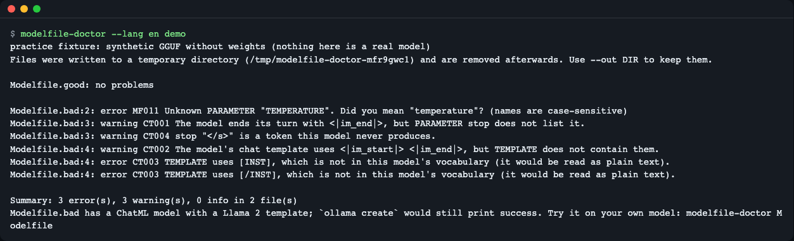
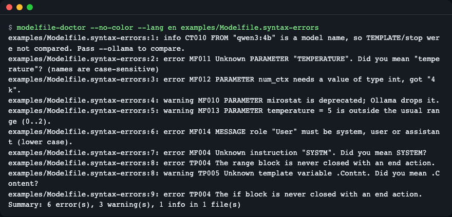
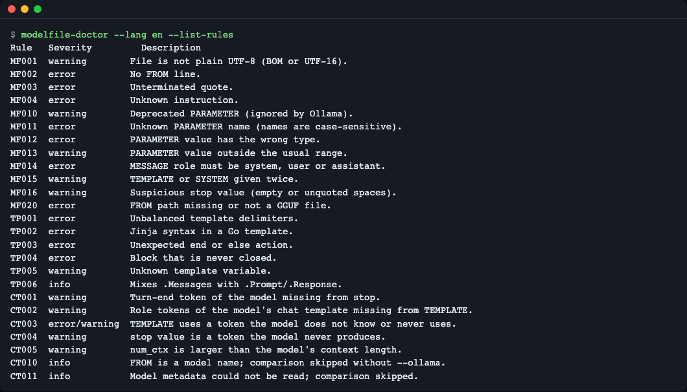
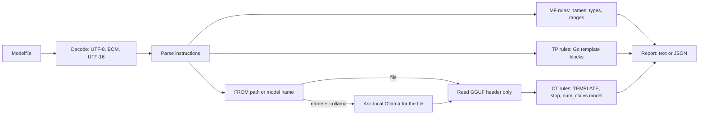

# modelfile-doctor

**English** | [한국어](README.ko.md)

[](https://github.com/LeeGyeongPil/modelfile-doctor/actions/workflows/ci.yml)  [](LICENSE)

Check an Ollama `Modelfile` before you run `ollama create`. It reports every syntax error at once, with line numbers, and compares your `TEMPLATE` and `stop` values with the chat format stored inside the GGUF model file, which Ollama itself does not do. English and Korean output, no runtime dependencies.


*The built-in demo: `Modelfile.good` passes, `Modelfile.bad` (a Llama 2 style template on a ChatML model) gets three errors and three warnings.*

## Why
A Modelfile like this passes `ollama create`, because Ollama only checks that the file parses:

```text
FROM ./model.gguf
PARAMETER stop "</s>"
TEMPLATE """[INST] {{ .Prompt }} [/INST]"""
```
If the model is a ChatML model, `[INST]` is not a special token for it and `</s>` is never produced, so the model answers badly or never stops. `modelfile-doctor` compares these lines with the chat format stored in the GGUF and says so before you create the model.

## Who this is for
- You download a GGUF file and write your own `Modelfile`, and `ollama create` printed `success` but the model rambles or never stops.
- You want every typo in a `Modelfile` (parameter names, value types, message roles, template blocks) listed in one run instead of one error per attempt.
- You want a check you can run in CI or a pre-commit step, with JSON output and exit codes.

## Install
Needs Python 3.10 or newer. Install [uv](https://docs.astral.sh/uv/) if you do not have it (`curl -LsSf https://astral.sh/uv/install.sh | sh`); on a minimal Linux image also make sure `git` and `curl` are installed.

```bash
# from a clone (what this README was verified with)
git clone https://github.com/LeeGyeongPil/modelfile-doctor
cd modelfile-doctor
uv sync
uv run modelfile-doctor --version
```
```text
modelfile-doctor 0.3.0
```

To put the command on your PATH: `uv tool install git+https://github.com/LeeGyeongPil/modelfile-doctor`. There are no runtime dependencies; `gguf` and `numpy` are only used by the tests.

## Quick start
The demo needs no model and no Ollama server. It writes a tiny practice GGUF (header only, no weights, nothing you could run) plus two Modelfiles, and checks them with the real rule engine.

```bash
uv run modelfile-doctor demo
```
```text
practice fixture: synthetic GGUF without weights (nothing here is a real model)
Files were written to a temporary directory (/tmp/...) and are removed afterwards. Use --out DIR to keep them.

Modelfile.good: no problems

Modelfile.bad:2: error MF011 Unknown PARAMETER "TEMPERATURE". Did you mean "temperature"? (names are case-sensitive)
Modelfile.bad:3: warning CT001 The model ends its turn with <|im_end|>, but PARAMETER stop does not list it.
Modelfile.bad:3: warning CT004 stop "</s>" is a token this model never produces.
Modelfile.bad:4: warning CT002 The model's chat template uses <|im_start|> <|im_end|>, but TEMPLATE does not contain them.
Modelfile.bad:4: error CT003 TEMPLATE uses [INST], which is not in this model's vocabulary (it would be read as plain text).
Modelfile.bad:4: error CT003 TEMPLATE uses [/INST], which is not in this model's vocabulary (it would be read as plain text).

Summary: 3 error(s), 3 warning(s), 0 info in 2 file(s)
Modelfile.bad has a ChatML model with a Llama 2 template; `ollama create` would still print success. Try it on your own model: modelfile-doctor Modelfile
```
Each line is `file:line: severity RULE message`. `MF` rules are about the Modelfile syntax, `CT` rules compare it with the model. The demo is a practice mode: the model is synthetic, so it shows how the checks behave, not how a real model would answer.

## Usage
| Command / option | What it does | Example |
|---|---|---|
| `modelfile-doctor PATH...` | Check one or more Modelfiles | `modelfile-doctor Modelfile` |
| `demo [--out DIR]` | Run the practice demo; `--out` keeps the generated files | `modelfile-doctor demo --out ./demo-files` |
| `inspect FILE.gguf` | Print the chat-related header fields of a GGUF file | `modelfile-doctor inspect model.gguf` |
| `--ollama [URL]` | Resolve `FROM model:tag` through a local Ollama server (default `$OLLAMA_HOST` or `http://127.0.0.1:11434`) | `modelfile-doctor --ollama Modelfile` |
| `--format text\|json` | Output format | `modelfile-doctor --format json Modelfile` |
| `--strict` | Warnings also give exit code 1 | `modelfile-doctor --strict Modelfile` |
| `--select IDS` / `--ignore IDS` | Only run / skip rules (ids or prefixes, comma separated) | `modelfile-doctor --select CT Modelfile` |
| `--list-rules` | Show every rule with its severity | `modelfile-doctor --list-rules` |
| `--lang en\|ko`, `--no-color` | Output language, no colors | `modelfile-doctor --lang ko Modelfile` |

Exit codes: `0` no errors, `1` errors found (or warnings with `--strict`), `2` usage or I/O problem (missing file, unreadable GGUF, Ollama not reachable).

### Scenario 1: find every syntax error in one run
The repository ships `examples/Modelfile.syntax-errors`, with a typo in almost every line:

```bash
uv run modelfile-doctor --no-color --lang en examples/Modelfile.syntax-errors
```
```text
examples/Modelfile.syntax-errors:1: info CT010 FROM "qwen3:4b" is a model name, so TEMPLATE/stop were not compared. Pass --ollama to compare.
examples/Modelfile.syntax-errors:2: error MF011 Unknown PARAMETER "TEMPERATURE". Did you mean "temperature"? (names are case-sensitive)
examples/Modelfile.syntax-errors:3: error MF012 PARAMETER num_ctx needs a value of type int, got "4k".
examples/Modelfile.syntax-errors:4: warning MF010 PARAMETER mirostat is deprecated; Ollama drops it.
examples/Modelfile.syntax-errors:5: warning MF013 PARAMETER temperature = 5 is outside the usual range (0..2).
examples/Modelfile.syntax-errors:6: error MF014 MESSAGE role "User" must be system, user or assistant (lower case).
examples/Modelfile.syntax-errors:7: error MF004 Unknown instruction "SYSTM". Did you mean SYSTEM?
examples/Modelfile.syntax-errors:8: error TP004 The range block is never closed with an end action.
examples/Modelfile.syntax-errors:8: warning TP005 Unknown template variable .Contnt. Did you mean .Content?
examples/Modelfile.syntax-errors:9: error TP004 The if block is never closed with an end action.
Summary: 6 error(s), 3 warning(s), 1 info in 1 file(s)
```
The exit code is `1` because errors were found. The `CT010` line is information only: `FROM qwen3:4b` is a model name, so there is no file to compare against unless you pass `--ollama`.


*Ten findings, each with its own line number.*

### Scenario 2: compare a Modelfile with the model (the part `ollama create` skips)
Keep the demo files, then check the bad Modelfile against the synthetic GGUF it points to:

```bash
uv run modelfile-doctor demo --out ./demo-files   # leaves Modelfile.* and a .gguf there; use a /tmp path if you prefer
uv run modelfile-doctor --no-color --lang en ./demo-files/Modelfile.bad
```
```text
./demo-files/Modelfile.bad:2: error MF011 Unknown PARAMETER "TEMPERATURE". Did you mean "temperature"? (names are case-sensitive)
./demo-files/Modelfile.bad:3: warning CT001 The model ends its turn with <|im_end|>, but PARAMETER stop does not list it.
...
Summary: 3 error(s), 3 warning(s), 0 info in 1 file(s)
```
(Run it to see all six lines; the output is the same as in the demo.) Read it like this: the model's own chat template uses `<|im_start|>` and `<|im_end|>` (CT002), it ends turns with `<|im_end|>` that `stop` does not list (CT001), `</s>` is never produced by this model (CT004), and `[INST]` is not even in the vocabulary, so it would be fed to the model as plain letters (CT003).

To look at what the tool read from the GGUF header:

```bash
uv run modelfile-doctor --lang en inspect ./demo-files/synthetic-chatml.gguf
```
```text
architecture:   llama
name:           practice-fixture
GGUF version:   3
context length: 4096
vocabulary:     6 tokens
EOS token:      <|im_end|>
BOS token:      -
EOT token:      -
chat template:  201 characters
role tokens:    <|im_start|> <|im_end|>
```

### Scenario 3: a model name instead of a file (`--ollama`)
If `FROM` is a model name such as `qwen3:4b`, the tool asks your local Ollama server (`/api/show`) where the model file is and compares against its header. Without `--ollama` it only prints the `CT010` info line and exits `0`. If the server is not running you get a one-line error and exit code `2`:

```bash
uv run modelfile-doctor --no-color --lang en --ollama http://127.0.0.1:9 examples/Modelfile.syntax-errors
```
```text
error: Cannot reach Ollama at http://127.0.0.1:9 ([Errno 61] Connection refused). Start it with `ollama serve` or pass --ollama URL.
```
The number in `[Errno 61]` is the macOS value; the same failure shows `[Errno 111]` on Linux.

This mode was verified here only against a small stub server in the tests, not against a real Ollama install. The tool runs on the machine where the model file is, so it needs that file to be readable.

### The other files in `examples/`
`examples/Modelfile.mismatch` and `examples/Modelfile.chatml-good` are two deliberate practice files for the same synthetic model: the first has the Llama 2 style template, the second is the matching ChatML one. They point to `./synthetic-chatml.gguf`, which is not in the repository, so run them next to a generated copy:

```bash
uv run modelfile-doctor demo --out ./demo-files
cp examples/Modelfile.mismatch examples/Modelfile.chatml-good ./demo-files/
uv run modelfile-doctor --no-color --lang en ./demo-files/Modelfile.mismatch ./demo-files/Modelfile.chatml-good
```
Expected: `Modelfile.mismatch` gives 2 errors and 3 warnings (the CT001 to CT004 lines from the demo), `Modelfile.chatml-good` gives `no problems`. Run directly from the repository (without the `.gguf` beside them) you only get `MF020 FROM path ... does not exist`, which is expected. `examples/Modelfile.syntax-errors` is the one from Scenario 1; its errors are intentional.

### Scenario 4: CI and scripts
```bash
uv run modelfile-doctor --format json --select CT ./demo-files/Modelfile.bad
```
prints a JSON array with one object per file: `path`, `encoding` and `diagnostics`, each diagnostic having `rule`, `severity`, `line`, `message_key`, `params`, `message` and `fixable` (always `false` for now). `message_key` and `params` do not depend on the language; only `message` is translated.


*`--list-rules` shows every rule id, its severity and a short description.*

Use it as a [pre-commit](https://pre-commit.com) hook; in `.pre-commit-config.yaml`:
```yaml
repos:
  - repo: https://github.com/LeeGyeongPil/modelfile-doctor
    rev: v0.3.0
    hooks:
      - id: modelfile-doctor
```
The hook runs on files named `Modelfile` or `Modelfile.*`. Pass options with `args:` (for example `args: [--ignore, MF020]` if the model files are not in the repository), and use `exclude:` to skip files such as `Modelfile.gguf`.

## Configuration
There is no config file. Only environment variables:

| Variable | Meaning |
|---|---|
| `MODELFILE_DOCTOR_LANG` | Output language `en` or `ko`. Order: `--lang`, then this variable, then `LC_ALL`, `LC_MESSAGES`, `LANG` (first non-empty wins; anything not starting with `ko` means English). |
| `OLLAMA_HOST` | Used by `--ollama` when you give no URL. Default `http://127.0.0.1:11434`. |
| `MODELFILE_DOCTOR_LIVE` | Tests only: `1` runs the test that needs a real local Ollama. |

The Korean screenshots in [README.ko.md](README.ko.md) were taken with `--lang ko`.

## Python API
The checks are also a small library (no extra dependencies). Everything below is exported from `modelfile_doctor`.

| Name | What it does |
|---|---|
| `lint_path(path, *, ollama_url=None, select=None, ignore=None)` | Read and lint a Modelfile; returns a `Report` |
| `lint_text(text, *, base_dir=".", gguf_meta=None, ...)` | Lint Modelfile text you already have; pass `gguf_meta` to compare against a model without touching disk |
| `read_gguf_metadata(path)` | Read the GGUF header into a `GGUFMetadata` (architecture, `chat_template`, `tokens`, EOS id, ...) |
| `Report.diagnostics` | List of `Diagnostic` with `rule`, `severity`, `line`, `message_key`, `params`; also `Report.errors`, `.warnings`, `.infos` |
| `DoctorError.code`, `.params` | Raised for I/O problems (missing file, GGUF passed as Modelfile, unreachable Ollama); `code` and `params` do not depend on the language |
| `render_error(exc, lang)` / `render(key, params, lang)` | Turn an error or a diagnostic key into a sentence in `en` or `ko` |

```python
from modelfile_doctor import lint_path, render_error, DoctorError

report = lint_path("examples/Modelfile.syntax-errors")
print(sorted({d.rule for d in report.diagnostics}))
for d in report.diagnostics[:2]:
    print(d.line, d.severity.value, d.rule, d.message_key, d.params)

try:
    lint_path("no-such-file")
except DoctorError as exc:
    print(exc.code, exc.params)
    print(render_error(exc, "en"))
```
```text
['CT010', 'MF004', 'MF010', 'MF011', 'MF012', 'MF013', 'MF014', 'TP004', 'TP005']
1 info CT010 diag.CT010 {'name': 'qwen3:4b'}
2 error MF011 diag.MF011.suggest {'name': 'TEMPERATURE', 'suggestion': 'temperature'}
io.not_found {'path': 'no-such-file'}
Cannot find "no-such-file". Check the path.
```
Run it from the repository root (`uv run python script.py`).

## How it works

- The file is decoded first, so a UTF-16 file without BOM is reported (MF001) instead of failing later.
- The parser splits the file into instructions with their line numbers; all later checks use those lines.
- MF rules check parameter names, value types and ranges, message roles and instructions; TP rules check the Go template (balanced `range`/`if`/`end`, leftover Jinja syntax, unknown variables).
- The GGUF reader reads only the key/value header (chat template, tokens, token types, end-of-sequence token, context length) and never the weights.
- CT rules compare what `TEMPLATE` and `stop` use with what the model actually knows and produces.

## Syntax rules (MF, TP)
`--list-rules` prints the full list; these are the ones you will meet most.

| Rule | Severity | Example |
|---|---|---|
| `MF002` / `MF004` | error | No `FROM` line, or an unknown instruction such as `SYSTM` |
| `MF011` / `MF012` | error | Unknown `PARAMETER` name (`TEMPERATURE`), or a value of the wrong type (`num_ctx 4k`) |
| `MF010` / `MF013` | warning | Deprecated parameter (`mirostat`), or a value outside the usual range (`temperature 5`) |
| `MF014` | error | `MESSAGE` role is not `system`, `user` or `assistant` |
| `MF020` | error | `FROM` path does not exist or is not a GGUF file |
| `MF021` | error | `ADAPTER` path does not exist (skip with `--ignore MF021`) |
| `TP001` to `TP004` | error | Unbalanced `{{ }}`, Jinja syntax in a Go template, stray `end`/`else`, a block that is never closed |
| `TP005` | warning | Unknown template variable (`.Contnt`) |

## Model comparison rules (CT)
These are the checks that compare your Modelfile with the model. `--list-rules` shows all other rules too. Rule sources: Ollama's [Modelfile reference](https://docs.ollama.com/modelfile) and its [parser.go](https://github.com/ollama/ollama/blob/main/parser/parser.go).

| Rule | Severity | Example |
|---|---|---|
| `CT001` | warning | The model ends turns with `<\|im_end\|>` but `PARAMETER stop` does not list it, so generation may not stop |
| `CT002` | warning | The model's chat template uses `<\|im_start\|>`, your `TEMPLATE` does not |
| `CT003` | error / warning | `TEMPLATE` uses `[INST]`, which is not in the vocabulary (error, it is read as plain text), or a token the model's own chat template never uses (warning) |
| `CT004` | warning | `stop "</s>"` is a token this model never produces |
| `CT005` | warning | `num_ctx` is larger than the model's context length |
| `CT010` / `CT011` | info | The comparison was skipped (`FROM` is a model name, or the GGUF header could not be read) |

## When to use it
- Good fit: you write or edit Modelfiles by hand for GGUF files and want a check before `ollama create`, or a CI step that fails on a broken Modelfile.
- Other tools for other jobs: a plain syntax-only Modelfile linter such as [owist-modelfile-lint](https://pypi.org/project/owist-modelfile-lint/) (check its README for what it covers), watching what Ollama does at request time → [Ollama](https://ollama.com) itself and its [Modelfile reference](https://docs.ollama.com/modelfile), inspecting GGUF files in depth → the [`gguf`](https://pypi.org/project/gguf/) Python package from llama.cpp.

## Limitations
- Which tokens are role or control tokens is decided by a pattern match plus the GGUF `token_type` values. This is a heuristic, so `CT002`, `CT003` and `CT004` can have false positives or miss something. If a finding is wrong for your model, skip it with `--ignore CT003`.
- `CT001` assumes that a turn-ending token missing from `stop` can make generation run on. How the Ollama runner treats it can differ by version, so read it as a warning, not as proof.
- The `PARAMETER` names and instruction tables are a snapshot of Ollama 0.40.15 (checked 2026-11-12). A newer Ollama may add parameters that this tool reports as `MF011` until the table is updated.
- `--ollama` only works when the model file that Ollama reports is readable on the same machine; remote Ollama servers are not supported. It was verified here only against a stub server, not a real install.
- `fixable` is always `false` for now: the tool reports problems but does not rewrite your file.
- Test gaps (known): there is no test that fails if the 4 MiB cap is removed from the Modelfile read, and the test for the "cannot create demo directory" message only checks the exit code and language, not the wording.
- A Modelfile larger than 4 MiB is refused, and a GGUF file passed as the Modelfile gets a hint to use `inspect`.

## Troubleshooting
| Symptom | Cause | Fix |
|---|---|---|
| `error: Cannot find "…"` and exit 2 | The path is wrong | Check the path; directories are not searched |
| `MF020 FROM path ... does not exist` | `FROM ./x.gguf` is resolved relative to the Modelfile, not to where you run the command | Fix the path or run on the right Modelfile |
| `MF021 ADAPTER path ... does not exist` | `ADAPTER` is resolved relative to the Modelfile (`~` is expanded); a directory counts as existing | Fix the path, or turn the rule off with `--ignore MF021` |
| `CT010` info only | `FROM` is a model name | Pass `--ollama` (Ollama must be running) |
| `CT011` info | The GGUF header could not be read (truncated or unsupported version) | Run `modelfile-doctor inspect FILE.gguf` to see the exact reason |
| Output is in the wrong language | Locale variables win only after `--lang` and `MODELFILE_DOCTOR_LANG` | Pass `--lang en` or `--lang ko` |

## Development
```bash
uv sync
uv run pytest -q
```
Tests build their GGUF fixtures on the fly; no model files and no Ollama are needed (one live test is skipped unless `MODELFILE_DOCTOR_LIVE=1`). Bugs and ideas are welcome as issues. Changes are listed in [CHANGELOG.md](CHANGELOG.md).

## License
MIT. The practice GGUF is generated by the tool itself and contains no model weights.
